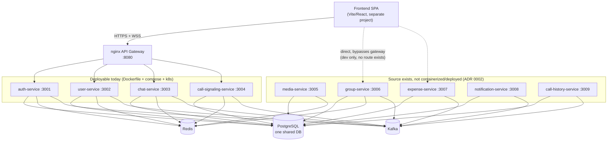
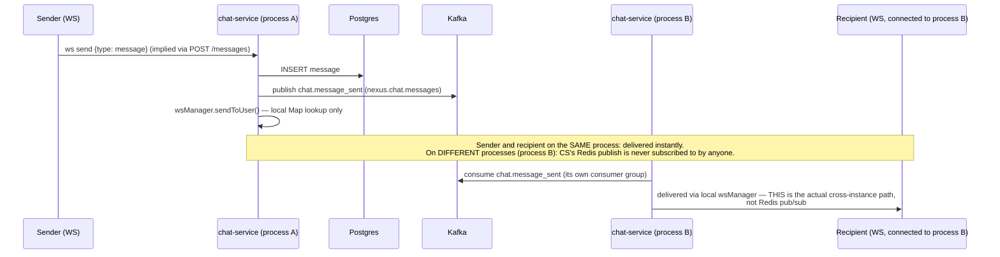
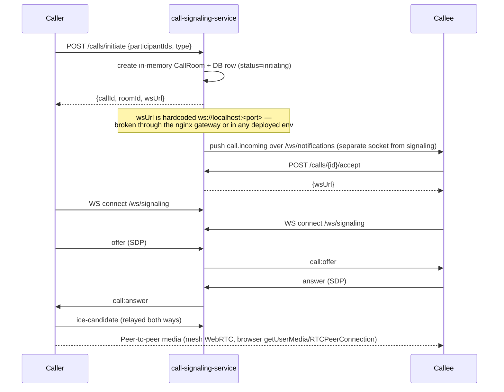
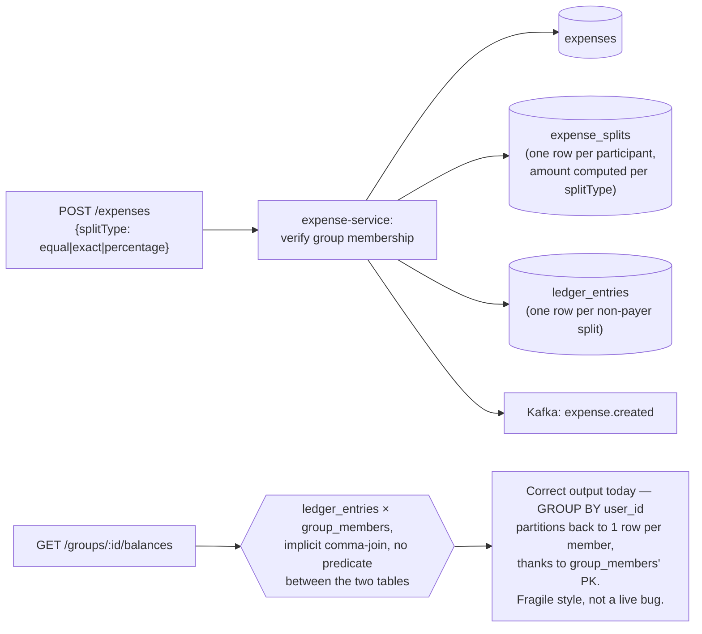
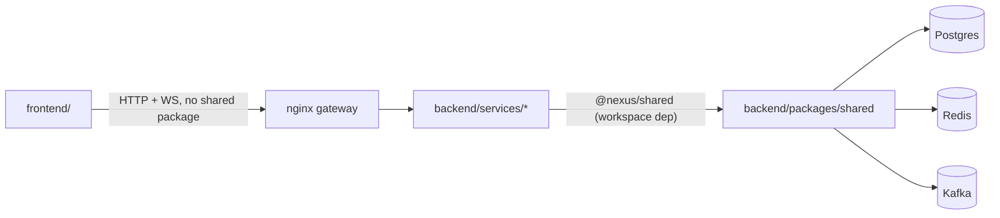

# Architecture

Nexus Connect is a microservices-based real-time communication platform: chat, WebRTC calling, group expense-splitting. Backend: 9 independent Fastify/TypeScript services behind an nginx gateway, sharing Postgres/Redis/Kafka. Frontend: a separate Vite/React SPA. See [MODULES.md](MODULES.md) for the per-module inventory this document assumes.

Every diagram below is marked **Verified** (confirmed by reading the code) or **Target** (described in `backend/README.md` but not confirmed, or confirmed *not* yet true). Don't treat a Target diagram as current behavior.

## 1. System topology — Verified, local/docker-compose configuration



`nginx.conf` only proxies `/api/v1/auth`, `/api/v1/users`, `/api/v1/search`, `/api/v1/chats`, `/api/v1/messages`, `/ws/chat`, `/api/v1/calls`, `/ws/signaling` — group-service and expense-service have no path through the local gateway at all today; reaching them requires calling their ports directly. `media-service`, `notification-service`, `call-history-service` aren't started by `docker-compose up` at all (not in `backend/docker-compose.yml`).

## 2. Auth flow — Verified

```mermaid
sequenceDiagram
    participant C as Client
    participant A as auth-service
    participant R as Redis
    participant PG as Postgres
    participant K as Kafka

    C->>A: POST /auth/register {email, password, displayName}
    A->>PG: INSERT user (unique_number retried up to 10x)
    A->>K: publish user.registered (nexus.user.events)
    A->>R: cache 6-digit verification code (24h TTL)
    A-->>C: 201 {userId, uniqueNumber}
    Note over A: email send is fire-and-forget;<br/>SMTP failure is swallowed, caller never learns

    C->>A: POST /auth/verify-email {email, code}
    A->>R: check code
    A->>PG: UPDATE users SET email_verified=true
    A->>K: publish user.email_verified

    C->>A: POST /auth/login {email, password}
    A->>PG: SELECT + bcrypt.compare
    A->>R: store refresh token (session key)
    A-->>C: 200 {accessToken (15m), refreshToken (7d)}

    C->>A: POST /auth/refresh {refreshToken}
    A->>R: verify + rotate (delete old, store new)
    A-->>C: 200 {new accessToken, new refreshToken}
```

Password reset is a **3-step flow** (`forgot-password` → `verify-reset-code` → `update-password`), all 6-digit-code based like email verification — not the token-link flow `backend/docs/api-contracts.md` currently documents, and not a 2-step flow. The frontend (`src/lib/api/auth.ts`) already calls the real 3-step endpoints; the written docs are what's behind. **Known gap:** changing a password does not revoke existing refresh tokens (explicit comment in `auth.service.ts`).

## 3. Real-time chat delivery — Verified, including the scaling limitation



**Critical invariant to know before changing this code:** `WebSocketManager` tracks connections in an in-process `Map`. It also writes connection membership to Redis (`SessionKeys.userConnections`) and calls `redis.publish(...)`, but **nothing in chat-service subscribes to those Redis channels** — the publish is a dead write. The actual (and only) cross-instance delivery path is the Kafka consumer re-pushing through each process's own local `wsManager`. This works for message events (because they're already published to Kafka for persistence) but **not** for anything that isn't also a Kafka event (e.g. a bare `typing:start`, which only exists in-memory and will not reach a user connected to a different replica). `call-signaling-service` has the same in-memory-only room state with an even smaller safety net: `CALL_ANSWERED`/`CALL_DECLINED`/`CALL_ENDED` Kafka consumer branches are empty stubs, so a second replica never learns a call ended on another instance. **Running more than one replica of `chat-service` or `call-signaling-service` today will silently drop some real-time events** — this contradicts `backend/README.md`'s scaling section, which describes Redis pub/sub as the cross-instance mechanism.

## 4. WebRTC call flow — Verified



The frontend does **pure mesh P2P WebRTC** and never calls `media-service`. `media-service`'s mediasoup Workers/Routers/Transports are real, but there are no `produce`/`connect`/`consume` routes, so even if the frontend called it, media could not flow end-to-end yet. For a 1:1 call the mesh works; for `isGroupCall`, the client loops participants for offer/ICE but this path is unverified at scale (built/exercised for 1:1). TURN env vars (`TURN_URL` etc.) are documented in `backend/docs/environment.md` but never read by any service — only public STUN is configured, so calls behind symmetric NAT will fail.

## 5. Expense-splitting data flow — Verified



Split computation (equal/exact/percentage) and the balances query's actual output are both correct, verified by independently simulating the query's row-by-row semantics. The balances query's comma-join style is still worth hardening — see [ENGINEERING_RULES.md](ENGINEERING_RULES.md#database-access--established-with-one-bug-to-know) for why it's fragile despite being correct today.

## Dependency direction



`frontend/` and `backend/` do not share any code or types — the frontend's `src/lib/api/types.ts` is a hand-maintained mirror of the backend's response shapes, not a generated or imported type. Keeping them in sync is a manual responsibility; there is no contract test enforcing it (see [TESTING.md](TESTING.md)).

## Critical invariants

- All inter-service communication is either synchronous HTTP (gateway-routed) or async via Kafka topics defined in `backend/packages/shared/src/messaging/topics.ts` — there is no service-to-service RPC.
- A single Postgres database and schema (`backend/infrastructure/postgres/init.sql`) is shared by all 9 services; each service owns a subset of tables by convention only (no DB-level enforcement, no separate schemas/users per service).
- JWT access/refresh secrets are shared across every service that validates tokens (`@nexus/shared`'s `authPlugin`) — there is no per-service signing key.
- Kafka event publishing is fire-and-forget: `KafkaClient.publish()` catches and logs failures rather than throwing (`backend/packages/shared/src/messaging/kafka.ts`) — callers must not assume an event was delivered just because the HTTP call succeeded.

## Known architectural risks (ranked)

1. **WebSocket/call-room state is process-local memory with no real cross-instance sync** (chat-service, call-signaling-service) — horizontal scaling is not safe today despite docs implying otherwise. See §3.
2. **`media-service` cannot carry real media traffic** (no produce/connect/consume) and has **no authentication plugin registered** — its routes are open to any caller. Do not point untrusted traffic at it.
3. **5 of 9 services have no deployment path** (Dockerfile/compose/k8s) — see [MODULES.md](MODULES.md) and [ADR 0002](docs/decisions/0002-partial-service-implementation.md).
4. **No automated tests anywhere** mean every refactor is unverified by anything but manual testing — see [TESTING.md](TESTING.md).
5. **Hardcoded `ws://localhost` URLs** returned by `call-signaling-service`'s `initiate`/`accept` responses mean calling doesn't work through the gateway or in any deployed environment yet.
